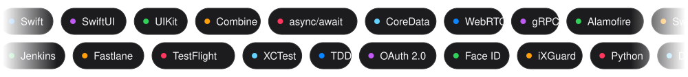

[Uploading README.md…]()

 

 

## About

Senior iOS Developer with **6+ years** building high-performance banking and mobile apps with **Swift, SwiftUI and UIKit**. I am also a **startup founder** (three ventures so far). I ship in Agile/Scrum teams, care deeply about architecture (MVVM, VIPER, Clean Architecture), and mentor junior developers through TDD and code reviews.

**Banking-grade security** (OAuth 2.0, Face ID / Touch ID, encryption, iXGuard) · **Real-time communication** (WebRTC, WebSocket, gRPC) · **Reactive and modern concurrency** (Combine, async/await) · **CI/CD** (Jenkins, Fastlane) · **AI-assisted development** (Copilot, Cursor, Claude, OpenAI API) · **Backend, mid-level** (Python, Django, DRF), able to build and deploy services end to end

## Tech Stack

## Experience

<b>Senior iOS Developer, Mellat Bank (Behsazan Mellat)</b> · Jan 2024 – Present

 

*Hamrah Bank Mellat · Swift, SwiftUI, UIKit, Combine, MVVM*

- Led the full app rewrite, introducing **SwiftUI alongside UIKit** for smoother animations, serving **100,000+ daily active users**
- Integrated **15+ features in one release cycle**, recognized as the "Most Innovative Update"
- Cut average task completion time by **25%** with redesigned core flows
- Maintained **99.9% uptime** by proactively resolving crashes and performance regressions

<b>Senior iOS Developer, Hasin Group</b> · Jan 2023 – Jan 2024

 

*Maani · Swift, UIKit, MVVM, Combine, Dependency Injection*

- Architected the app with MVVM, DI, Combine and SOLID for maintainability and testability
- Eliminated **100% of memory leaks** with Instruments, improving load speed by **30%**
- Added Face ID / Touch ID, cutting login time by **50%**
- Built an offline-first architecture (CoreData + REST sync) with **zero data-loss incidents in 12 months**

<b>iOS Developer, Karafarin Bank</b> · Feb 2022 – Feb 2023

 

*Hay Bank · Swift, SwiftUI, UIKit, Combine, CoreData, Alamofire, Jenkins, Fastlane*

- Built a full-featured mobile banking app with SwiftUI and custom UIKit components
- Implemented **MVVM-C-D** with DI, improving navigation performance by **30%**
- Established **CI/CD** (Jenkins, Fastlane) and TestFlight distribution

<b>iOS Developer (Freelance), Palphone</b> · Feb 2022 – Feb 2023

 

*Swift, SwiftUI, WebRTC, MediaSoup, SocketIO, gRPC*

- Built a secure real-time app for **encrypted voice and video calls**
- Used MVVM+R with Swinject for dependency injection

<b>iOS Developer, Basir Andishan Bina Tadbir</b> · Jul 2020 – Feb 2022

 

- Published **3 apps**: XenoticTracker, StelockTracker, ActiveTracker
- Redesigned G14 GAP (**+30% engagement**) and replaced SMS control with OTP authentication
- Refactored FIREWALL from Objective-C/MVC to Swift/MVVM
- Built WIFI Siren with UIKit, MVVM and UDP sockets

<b>iOS Developer, SazeKomak</b> · May 2019 – Jul 2020

 

- Built the app with Swift, MVC, CoreData and WebSocket for real-time sync
- Cut load time by **40%**, improving user satisfaction and App Store ratings

## Published Apps

| App | Company | Stack |
|:--|:--|:--|
| **Hamrah Bank Mellat** | Mellat Bank | Swift, SwiftUI, UIKit, Combine, MVVM |
| **Hay Bank** | Karafarin Bank | Swift, SwiftUI, UIKit, MVVM-C-D, Combine, CoreData |
| **Maani** | Hasin Group | Swift, UIKit, MVVM, Combine, DI |
| **Palphone** | Side project | Swift, WebRTC, MediaSoup, SocketIO, gRPC |
| **G14 GAP** | Basir Andishan | Swift, UIKit, OTP |
| **FIREWALL** | Basir Andishan | Swift, Objective-C, MVVM |
| **WIFI Siren** | Basir Andishan | Swift, UIKit, MVVM, UDP Socket |
| **XenoticTracker** | Basir Andishan | Swift, UIKit, MVVM, CoreLocation |
| **StelockTracker** | Basir Andishan | Swift, UIKit, CoreData |
| **ActiveTracker** | Basir Andishan | Swift, UIKit, HealthKit |

## Founder

**[My Family (خانواده من)](https://app.khanevadehman.ir/)** is my third startup, which I founded with my co-founders. It is a Persian-language family health platform that keeps the health information of the whole family in one place. The marketing site and SEO blog live at [khanevadehman.ir](https://khanevadehman.ir) and bring users into the app.

**What the app does**

- **Family profiles:** adults with their own accounts (verified by OTP), minors, and adults without accounts, all managed under one family
- **My Child:** a profile card for each child with BMI, blood type and the medication list
- **Lab results with OCR:** upload a PDF or photo of a lab test and the app extracts the results, recognizing 170+ Iranian lab test names
- **Period tracker:** cycle analysis with lateness detection, progress and tiered warnings, for multiple profiles
- **Drug database:** Iranian drug data collected from several public sources and normalized for search
- **Persian-first experience:** full RTL layout, dark mode, and a smooth OTP login
- **Coming next:** drug interaction checking

**My role:** I design and build the product and its Python/Django backend, run the servers, and publish the services myself. My backend level is solid mid-level: I build APIs, data models, background processing and deployments end to end, and I keep the system simple enough for a small team to run.

My two earlier startups did not survive the difficult conditions in Iran during the last two wars. Building them taught me product thinking, shipping with limited resources, and how to keep going when circumstances change overnight. I carry all of that into My Family and into the teams I work with.

## Activity

**Education:** Associate Degree in Information Technology, Elmi Karbordi University (2012) · **Languages:** English (Professional), Persian (Native)

Open to senior iOS roles and collaborations on impactful mobile projects.

